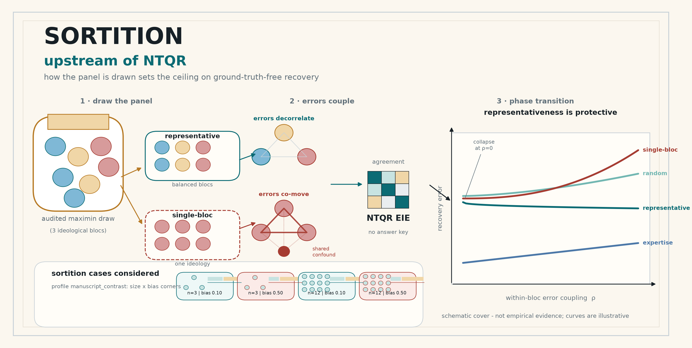

# NTQR_allotment

  
  

  

**Sortition upstream of NTQR** — a research testbed for how *forming an expert
panel* and *how many experts you draw* shape what no-answer-key evaluation can
infer about noisy experts of known precision, bias, and heterogeneity.

Here "ground-truth-free" is project shorthand for evaluation from unlabeled
decision data. The primary synthetic analysis hides labels during the algebraic
solve, then uses authored labels to select the oracle comparator branch and
score recovery.

Two upstream libraries are imported and used for real:

- [`allotment`](https://github.com/Citizen-Infra/allotment) (AGPL-3.0) — an
  auditable fair-sortition engine (maximin stratified lottery, Flanigan et al.
  *Nature* 2021). Draws a representative mini-public by reproducible, SHA-256
  audited lottery.
- [`ntqr`](https://ntqr.readthedocs.io/) (MIT) — algebraic logic tools for
  unsupervised evaluation of noisy binary classifiers from unlabeled decision
  data. In this project, its error-independent three-classifier evaluator returns
  the possible logically consistent prevalence and per-classifier accuracy
  evaluations implied by agreement/disagreement patterns, **without an answer
  key**.

## Documentation

Start with the [offline reproduction guide](docs/reproduction.md) to replay
the seeded synthetic study using its locked environment and retained
evidence. The offline path uses no live adjudication provider.

- [Documentation index](docs/README.md) for setup, configuration, and verification.
- [Study overview](docs/study.md) for the research question, methods, and figures.
- [Manuscript](docs/manuscript/README.md) for the canonical paper.
- [Publication package](docs/PUBLICATION_PACKAGE.md) for the release record.
- [Reproduce and render offline](docs/reproduction.md) using retained evidence.

The [MIT License](LICENSE) covers project code. Third-party dependencies keep
their own licenses. [Dependency notes](docs/dependencies.md)
